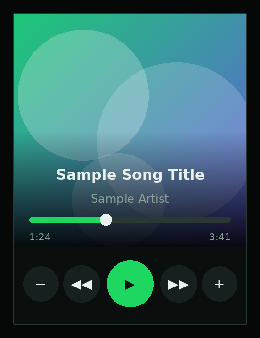
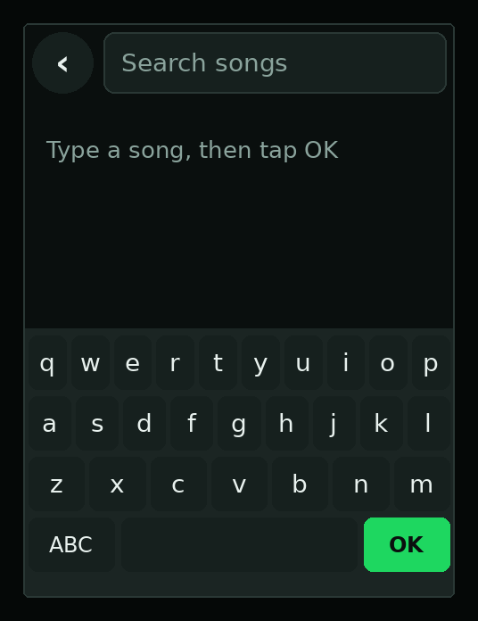
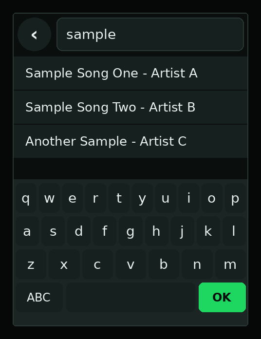

# mini-Spotify (PC bridge edition)

<!-- mini-spotify-images:begin -->
## Screenshots

Renders of the 240x320 display on the Viewe 2.8" ESP32-S3 board. These are mockups drawn from the firmware layout, with placeholder art and sample song names, not photos of the device.

<table>
  <tr>
    <td align="center"> Player screen</td>
    <td align="center"> Search screen</td>
    <td align="center"> Search results</td>
  </tr>
</table>
<!-- mini-spotify-images:end -->

Now-playing display + remote for the Viewe 2.8" ESP32-S3 (PlatformIO, LVGL 9.5).
No Spotify account/API needed: a small script on your PC reads the desktop player over MPRIS
(`playerctl`) and the ESP32 talks to it over Wi-Fi. Works with the Spotify desktop app on the
free plan, and with browsers, VLC, etc.

## PC
1. `sudo apt install playerctl` (or your distro's package). Optional: `pip install pillow` (converts art to JPEG).
2. `python3 bridge/mini_player_bridge.py` - prints the URL. Test: `curl localhost:8765/state`.
3. Open the firewall if needed: `sudo ufw allow 8765/tcp`.
Env: `MINI_PLAYER` (default `spotify,%any`), `MINI_PORT`, `MINI_TOKEN` (shared secret).

## ESP32
Edit `include/secrets.h`: `WIFI_SSID`, `WIFI_PASS`, `BRIDGE_HOST` (PC IP from `hostname -I`).
Then `pio run -t upload && pio device monitor`. The PC and the board must be on the same network
(public/campus Wi-Fi often isolates devices; a phone hotspot or home router avoids that).

## Controls
Prev / play-pause / next, seek slider (release to seek), volume slider.
The bridge is plain HTTP on your LAN: anyone on it can control playback unless you set `MINI_TOKEN`.

## PC bridge service

Run `bridge/install-service.sh` to start the bridge at login. Logs: `journalctl --user -u mini-spotify-bridge -f`.
Set the bridge address from the board: gear icon, Wi-Fi setup, then the "PC bridge address" field.
The `BRIDGE_HOST` value in `include/secrets.h` is used when nothing is saved.

<!-- mini-spotify:begin -->
## Features

- **Now playing:** title, artist, progress and a full-width 240x240 cover from the PC bridge (the bridge sends 480px art; install `pillow` on the PC for sharp covers).
- **Controls:** volume down/up, previous, play/pause, next.
- **Two modes:** PC bridge over Wi-Fi, or a Bluetooth media remote. The board pairs as "MiniSpotify" and sends play/pause, next, previous and volume keys. The mode is saved across reboots.
- **Wi-Fi setup page:** the board remembers its Wi-Fi. With no saved network, or if the first connection fails for 25 seconds, it opens the "MiniSpotify-Setup" access point. Join it and open `192.168.4.1` to pick a network and set the PC bridge address.
- **Search:** type a song on the board, the bridge searches Spotify, tap a result to play it on the PC.

## Search setup

Search uses the Spotify Web API from the PC bridge, so the secret never reaches the board.

1. Create an app at https://developer.spotify.com/dashboard. New apps need a Premium account on the owner's side, and search returns at most 10 results (the board asks for 8).
2. Put the credentials in `~/.config/mini-spotify-bridge.env` (see `bridge/mini-spotify-bridge.env.example`):

3. Restart the bridge: `systemctl --user restart mini-spotify-bridge`.
4. Check it: `curl "localhost:8765/search?q=daft%20punk"` should return JSON with `results`.

Playing a result runs `playerctl open spotify:track:<id>`, which needs the Spotify desktop app.

## Bridge endpoints

| Endpoint | Purpose |
| --- | --- |
| `GET /state` | now-playing JSON |
| `GET /art` | album art as JPEG |
| `POST /cmd?c=<toggle\|next\|prev\|volume\|seek>&v=<n>` | player commands |
| `GET /search?q=<text>` | Spotify track search |
| `POST /play?id=<track id>` | play a track |

Environment variables: `MINI_PLAYER`, `MINI_PORT`, `MINI_TOKEN`, `SPOTIFY_CLIENT_ID`, `SPOTIFY_CLIENT_SECRET`. If `MINI_TOKEN` is set, put the same value as `BRIDGE_TOKEN` in `include/secrets.h`.

## Optional on-screen buttons

The mode (Wi-Fi/Bluetooth) button, the settings button and the search button are hidden by default. To show them, add flags to `build_flags` in `platformio.ini` and reflash:

With the settings button hidden you cannot reopen the Wi-Fi setup page from the screen, and with the search button hidden search cannot be opened, so turn them on when you need those.

## Configuration

Secrets live in `include/secrets.h`, which is git-ignored: `WIFI_SSID`, `WIFI_PASS`, `BRIDGE_HOST` and optionally `BRIDGE_PORT` and `BRIDGE_TOKEN`. Wi-Fi and the bridge address saved from the setup page take priority over these values.
<!-- mini-spotify:end -->

<!-- mini-spotify-stack:begin -->
## Tech stack

**Hardware**
- Viewe 2.8" 240x320 touch display board (`UEDX24320028E-WB-A`) with an ESP32-S3: dual core 240 MHz, Wi-Fi, Bluetooth LE, 16 MB flash and octal PSRAM.

**Firmware (C++17)**
- [PlatformIO](https://platformio.org/) with the Arduino framework for ESP32 (`espressif32` platform pinned to a fixed commit).
- [LVGL](https://lvgl.io/) 9.5.0 for the UI: player screen, search screen and on-screen keyboard.
- ESP32_Display_Panel and `esp-lib-utils` for the display, touch and board drivers.
- [ArduinoJson](https://arduinojson.org/) 7 to parse the bridge's JSON.
- [JPEGDEC](https://github.com/bitbank2/JPEGDEC) to decode album art into PSRAM.
- [NimBLE-Arduino](https://github.com/h2zero/NimBLE-Arduino) 2.x for the Bluetooth HID media remote.
- ESP32 Arduino libraries: `WiFi`, `HTTPClient`, `WebServer` and `DNSServer` (Wi-Fi setup page), and `Preferences` (settings in NVS).
- FreeRTOS tasks and queues keep networking and search off the UI loop.

**PC bridge (Python 3)**
- `http.server` from the standard library serving a small JSON/HTTP API on the LAN.
- [`playerctl`](https://github.com/altdesktop/playerctl) (MPRIS) to read and control the desktop player.
- [Pillow](https://python-pillow.org/) (optional) to resize and convert cover art to JPEG.
- [Spotify Web API](https://developer.spotify.com/documentation/web-api) (client-credentials flow) for track search.
- `systemd` user service so the bridge starts at login.

**Tooling**
- Git and GitHub for version control.
- LVGL's XML UI project in `lvgl_ui/` for editing the layout in the LVGL editor. The firmware builds the screens in C++ and does not load the XML.
<!-- mini-spotify-stack:end -->
